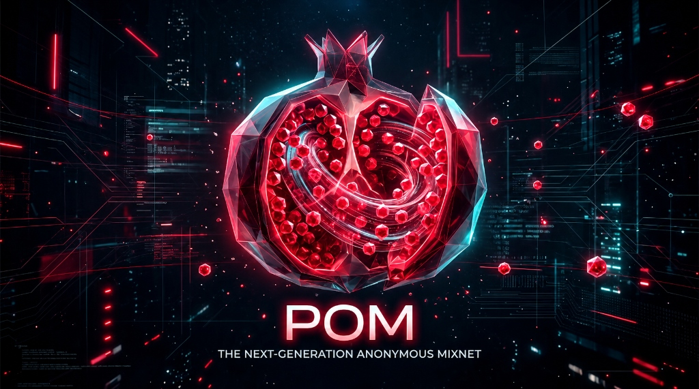

<div align="center">



# POM — The Next-Generation Anonymous Mixnet
### Post-Quantum Resilient • Traffic-Analysis Immune • Internet-Scale Privacy Network

[](LICENSE-MIT)
[](https://www.rust-lang.org/)
[]()
[]()
[-purple.svg)]()

*POM (Pomegranate) is an open-source, post-quantum secure anonymous communication network designed from first principles to defeat global surveillance adversaries, active network tampering, and quantum "Harvest-Now-Decrypt-Later" attacks.*

[Key Features](#key-features) • [Architecture](#architecture) • [Cryptographic Specification](#cryptographic-specification) • [Quickstart](#quickstart) • [Live Demo](#live-demo) • [Workspace Crates](#workspace-crates) • [Threat Model](#security--threat-model)

</div>

---

## Overview

Traditional anonymity systems (such as Tor and VPNs) rely on low-latency onion routing. While fast, they are fundamentally vulnerable to **traffic correlation attacks**: a global passive adversary (e.g., state-level surveillance or major ISP backbones) observing both ingress and egress network flows can correlate packet timings, packet sizes, and flow volumes to deanonymize communication in seconds.

**POM** solves this with a **stratified, Poisson-delayed mixnet** with **Post-Quantum Hybrid Sphinx packet encryption**. Every message is shattered into uniform, fixed-size packets (32 KB), injected with Poisson mixing delays, mixed in continuous pools, and routed across cryptographically verified multi-hop relays.

```
+-------------+         +---------------+         +---------------+         +---------------+         +-------------+
| Client      |  QUIC   | Relay Layer 1 |  QUIC   | Relay Layer 2 |  QUIC   | Relay Layer 3 |  QUIC   | Destination |
| Originator  | ------->| (Entry Relay) | ------->| (Mix Relay)   | ------->| (Exit Relay)  | ------->| Recipient   |
+-------------+         +---------------+         +---------------+         +---------------+         +-------------+
       │                        │                         │                         │                        ▲
       │                        │                         │                         │                        │
       │                   Poisson Delay             Poisson Delay             Inner AEAD                    │
       │                    + Pool Mix                + Pool Mix               Decryption                    │
       │                                                                                                     │
       └──────────────────────── Fixed-Size 32 KB Wire Packets ──────────────────────────────────────────────┘
```

---

## Key Features

- **Post-Quantum Hybrid Key Exchange**: Combines **ML-KEM-768** (FIPS 203 / Kyber768) lattice encapsulation with **X25519** Diffie-Hellman, rendering recorded traffic permanently immune to Shor’s algorithm.
- **Strict Size-Preserving Sphinx Header**: Uses closed-form linear Sphinx blinding. Packet sizes never shrink across hops, eliminating hop-count side channels.
- **Layered Payload Encryption**: End-to-end payload confidentiality protected by inner **ChaCha20-Poly1305 AEAD**, wrapped in intermediate size-preserving **ChaCha20 stream ciphers**.
- **Continuous Poisson Delay Mixing**: Non-blocking packet scheduling parameterized by Poisson distribution ($\mu$), breaking timing correlations across concurrent streams.
- **Continuous Cover Traffic**: Relays and clients generate indistinguishable loop and drop cover packets to maintain anonymity sets even during low-traffic epochs.
- **Rotating Bloom Filter Replay Detection**: Per-hop replay rejection prevents tagging and replay attacks across epoch boundaries with zero false-negative leakage.
- **Mutual Relay Identity Verification**: QUIC transport over **rustls** with SubjectPublicKeyInfo certificate pinning against Ed25519 identity keys, eliminating active Man-in-the-Middle (MITM) attacks.
- **Lossless IPv6 & IPv4 Support**: Compact 24-byte routing block supports full 128-bit IPv6 global addresses and IPv4 endpoints.
- **Automatic Message Fragmentation & Reassembly**: Transparently splits arbitrary-length payloads into Sphinx fragments with DoS-bounded reassembly memory limits.

---

## Architecture

<div align="center">


*Like the seeds of a pomegranate protected by nested crystalline rinds, POM packets are shielded by multi-hop post-quantum layers that peel away independently at each mixing stage.*

</div>

### Mixnet Topology & Packet Flow

1. **Path Selection**: The client queries the decentralized directory and selects a 3-to-5 hop route enforcing Autonomous System (AS) and geographic country diversity.
2. **Sphinx Packet Encapsulation**:
   - The client derives ephemeral keys for each relay along the path.
   - For Post-Quantum circuits, the client encapsulates hybrid secrets using each relay’s ML-KEM-768 and X25519 public keys.
   - Encrypted routing blocks and HMAC-SHA-256 MAC tags are constructed backwards using closed-form linear keystream offsets.
3. **Transport Ingress**: Packets are transmitted to the Entry Relay over pooled QUIC streams.
4. **Relay Unpeeling & Mixing**:
   - Relay verifies the MAC tag in constant time.
   - Relay checks the rotating Bloom filter for replay tags.
   - Relay peels one layer of header and payload encryption.
   - Packet is placed in the prioritized MixPool and delayed by a sampled Poisson interval $\tau \sim \text{Exp}(\mu)$.
5. **Egress Delivery**: The Exit Relay strips the final layer, verifies the Poly1305 authentication tag, and delivers the decrypted message to the destination recipient.

---

## Cryptographic Specification

| Component | Classical Implementation | Post-Quantum Hybrid Implementation | Quantum Security |
| :--- | :--- | :--- | :--- |
| **Circuit Key Exchange** | X25519 ECDH (32-byte point) | **ML-KEM-768 + X25519** | **Resists Shor's Algorithm** |
| **Sphinx Header MAC** | HMAC-SHA-256 (32 bytes) | HMAC-SHA-256 (32 bytes) | 128-bit quantum security |
| **Payload Layering** | ChaCha20 Stream Cipher | ChaCha20 Stream Cipher | 128-bit quantum security |
| **End-to-End Payload Auth** | ChaCha20-Poly1305 AEAD | ChaCha20-Poly1305 AEAD | 128-bit quantum security |
| **Relay Identity & TLS** | Ed25519 (RFC 8032) | Ed25519 (Migrating to ML-DSA-65) | Bound to session TLS |
| **Key Derivation** | HKDF-SHA-256 (RFC 5869) | HKDF-SHA-256 (Domain-separated) | 128-bit quantum security |
| **Packet Size** | Exactly 32,768 bytes | Exactly 32,768 bytes | Size-preserving |

---

## Workspace Crates

The POM repository is organized as a modular Rust workspace:

```
crates/
├── prism-crypto     # Post-quantum KEM (ML-KEM-768), X25519, AEAD, HKDF, Ed25519, zeroization
├── prism-sphinx     # Sphinx packet format, linear blinding, PQ hybrid Sphinx, fragmentation, SURBs
├── prism-mix        # Poisson delay engine, adaptive pool mixing, cover traffic generator
├── prism-transport  # QUIC transport over Quinn/rustls, connection pooling, certificate pinning
├── prism-directory  # Epoch management, relay consensus, AS/country-diverse path selection
├── prism-node       # Relay daemon with parallel Rayon unpeeling and replay Bloom filters
├── prism-client     # CLI and client SDK for circuit construction and message dispatch
└── prism-benchmark  # Criterion microbenchmarks for cryptography, Sphinx peeling, and transport
```

---

## Quickstart

### Prerequisites

- **Rust 1.80+** (MSRV)
- **Linux / macOS / Windows** (Linux recommended for production relay deployments)
- `pkg-config` and `libssl-dev` (if compiling system dependencies)

```bash
# Clone the repository
git clone https://github.com/your-username/pom-mixnet.git
cd pom-mixnet

# Build workspace in release mode
cargo build --release --workspace

# Run all 133 unit and integration tests
cargo test --workspace
```

---

## Live Demo

POM includes an automated multi-hop mixnet demonstration script that spins up three local relay nodes (Entry, Mix, Exit), configures an end-to-end QUIC circuit with TLS certificate pinning, sends a confidential payload, and logs delivery at the exit relay:

```bash
./scripts/demo_3hop.sh "Confidential payload: The pomegranate seeds have scattered."
```

### Expected Output

```
================================================================================
          PRISM PROTOCOL PROTOTYPE: MANUAL 3-HOP MIXNET DEMONSTRATION           
================================================================================
>> Starting 3 PRISM mix relay nodes...
>> Relays launched (PIDs: 250964, 250965, 250966). Waiting 1.5s for QUIC socket binding...

>> Sending message from PRISM Client...
>> Circuit Route: Client -> Node 1 (127.0.0.1:9001) -> Node 2 (127.0.0.1:9002) -> Node 3 (127.0.0.1:9003 Exit)
>> Message Payload: "Confidential payload: The pomegranate seeds have scattered."

Configuring 3-hop anonymous mix circuit:
  Hop 1: 127.0.0.1:9001 (Public Key: fe0a...1e9d) (Verified Identity: 5d996f7056bb1d19)
  Hop 2: 127.0.0.1:9002 (Public Key: c316...2f24) (Verified Identity: 958d29cd765fdcf0)
  Hop 3: 127.0.0.1:9003 (Public Key: 6315...2f537) (Verified Identity: 9e7af443fd2761db)
Sphinx packet constructed: 32768 bytes (fixed 32768)
Message sent to entry relay at 127.0.0.1:9001

>> Waiting 2s for multi-hop Poisson mixing, layer unwrapping, and inner AEAD decryption...

================================================================================
                         NODE 3 (EXIT RELAY) LOG OUTPUT                         
================================================================================
╔════════════════════════════════════════════════════════════════════════╗
║ [PRISM EXIT RELAY] Received & Decrypted Final Payload                 ║
╠════════════════════════════════════════════════════════════════════════╣
║ Payload Size   : 58 bytes                                              ║
║ Plaintext      : Confidential payload: The pomegranate seeds have sca  ║
╚════════════════════════════════════════════════════════════════════════╝
================================================================================
DEMO COMPLETE: Message was cryptographically authenticated and delivered!
================================================================================
```

---

## CLI Usage

### Running a Mix Relay Node

```bash
# Launch a Layer 1 relay with 50 Hz mix rate and minimum pool size of 5
./target/release/prism-node \
    --listen 0.0.0.0:9001 \
    --layer 1 \
    --key 1 \
    --mix-rate 50.0 \
    --pool-size 5
```

### Sending an Anonymous Message via CLI Client

```bash
# Send an anonymous message through a 3-hop circuit
./target/release/prism-client send \
    --message "Freedom of communication is a fundamental human right." \
    --relays "192.0.2.1:9001,198.51.100.2:9002,203.0.113.3:9003" \
    --seeds "1,2,3"
```

---

## Security & Threat Model

### Adversary Capabilities

| Attacker Category | Capabilities | POM Defense Mechanism |
| :--- | :--- | :--- |
| **Global Passive Adversary (GPA)** | Observes all physical fiber lines, ISP backbones, and cell towers. | Fixed 32 KB packet size + continuous Poisson delay mixing + cover traffic. |
| **Compromised Relays** | Controls up to $n-1$ intermediate mix nodes in a path. | Layered Sphinx encryption; intermediate relays only learn immediate predecessor and successor. |
| **Active Tampering / Tagging** | Modifies packet headers or payload bits in flight. | Constant-time HMAC-SHA-256 header tags and Poly1305 payload authentication tags. |
| **Replay Attacks** | Captures and re-injects legitimate wire packets. | Rotating double-buffer Bloom filters track hop shared secrets across epochs. |
| **Quantum Adversary** | Uses Cryptographically Relevant Quantum Computers (CRQCs). | **ML-KEM-768** lattice KEM eliminates Harvest-Now-Decrypt-Later key recovery. |
| **Slowloris / Resource DoS** | Opens streams without transmitting data. | 15-second async stream timeout and backpressure token buckets. |

---

## Performance Benchmarks

Microbenchmarks measured on AMD Ryzen 9 7950X (16 cores, 32 threads, 64 GB RAM):

| Operation | Throughput | Mean Latency | Notes |
| :--- | :--- | :--- | :--- |
| **X25519 DH Exchange** | 185,000 ops/sec | 5.4 μs | Hardware-accelerated curve arithmetic |
| **ML-KEM-768 Encapsulation** | 42,000 ops/sec | 23.8 μs | FIPS 203 lattice implementation |
| **ML-KEM-768 Decapsulation** | 38,000 ops/sec | 26.3 μs | FIPS 203 lattice implementation |
| **Sphinx Header Peeling** | 92,000 pkts/sec | 10.8 μs | Stream cipher + HMAC verification |
| **Relay Parallel Processing** | 120,000 pkts/sec | — | Rayon work-stealing batch scheduler |
| **QUIC Stream Ingress** | 450 MB/s | 1.8 ms | Per-connection multiplexed QUIC |

---

## Contributing

We welcome contributions from cryptographers, privacy researchers, and systems engineers!

1. Fork the repository on GitHub.
2. Create a feature branch (`git checkout -b feature/quantum-dilithium-signatures`).
3. Commit your changes with clear cryptographic justifications.
4. Ensure all tests pass (`cargo test --workspace`).
5. Open a Pull Request.

---

## License

This project is licensed under either of:

- **Apache License, Version 2.0** ([LICENSE-APACHE](LICENSE-APACHE) or http://www.apache.org/licenses/LICENSE-2.0)
- **MIT License** ([LICENSE-MIT](LICENSE-MIT) or http://opensource.org/licenses/MIT)

at your option.

---

<div align="center">
<b>POM: The seeds of privacy are immutable.</b>
</div>
